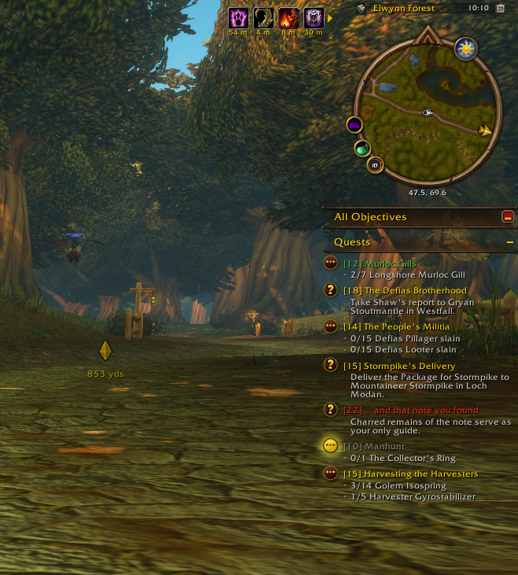
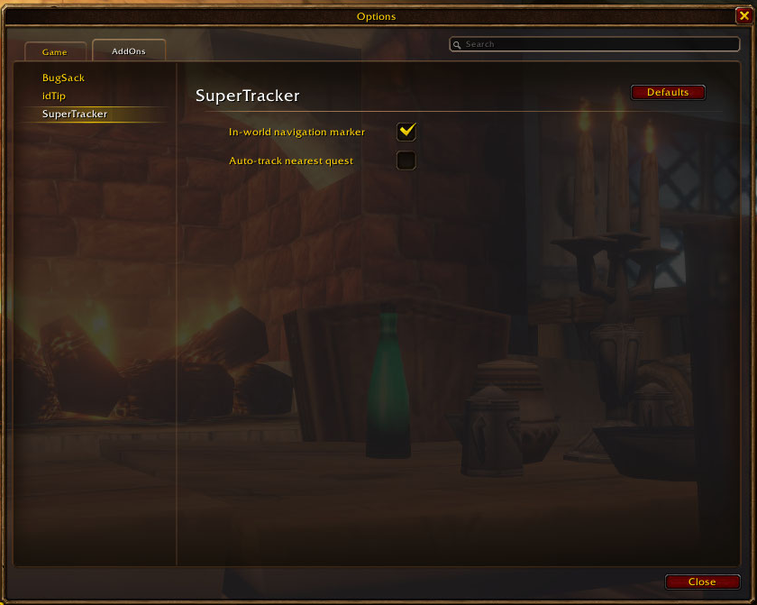

# SuperTracker

A small quality-of-life addon for **WoW: Forever** that restores the retail **in-world quest navigation
marker**: the golden diamond that floats over your destination and shows the distance in yards.

## Why

The Forever client ships the complete retail navigation system, but the option that turns it on
(`showInGameNavigation`) is off by default and missing from the menus. SuperTracker switches it on and adds
a few conveniences around it.

## Features

- **In-world marker** for the tracked quest or map pin, with distance. Click a quest in the objective
  tracker to track it.
- **Auto-track:** when nothing is tracked (a quest was turned in or abandoned, a map pin was cleared or
  reached), the nearest quest in your quest log is tracked automatically.
- **`/way` map pins:** set a map pin from chat and navigate to it straight away.
- **Follow the RestedXP arrow** (optional, needs RestedXP Guides): the marker follows the RestedXP guide
  arrow, also on "go to" steps, and also when the RestedXP arrow itself is hidden. A pin you or another
  add-on set is never replaced; once it is cleared, the marker goes back to the guide.
- Settings under **Options → AddOns → SuperTracker**.

## Screenshots

  
  

## Commands

| Command | Effect |
|---|---|
| `/supertracker` | open the settings |
| `/supertracker on` / `off` / `toggle` | turn the in-world marker on or off |
| `/supertracker rxp` | turn following the RestedXP arrow on or off |
| `/supertracker status` | show what is tracked, the nearest quest, what SuperTracker reads from the RestedXP arrow and whose map pin is set |
| `/supertracker cpu` | show SuperTracker's CPU use (and RestedXP's and all add-ons' for comparison) |
| `/supertracker debug` | show auto-track decisions in chat, for troubleshooting (run it again to turn it off) |
| `/way 42.5 66.6` | map pin at 42.5, 66.6 on your current map, and track it |
| `/way 1429 42.5 66.6 Gryan` | map pin on a given map ID, with an optional note |
| `/way clear` | remove the map pin |

If TomTom is installed, `/way` is left to TomTom; `/stway` always works.

## Installation

Install it with the CurseForge app ([SuperTracker on CurseForge](https://www.curseforge.com/wow/addons/supertracker))
or the Wago app ([SuperTracker on Wago](https://addons.wago.io/addons/supertracker)), or download the zip from the
[latest release](https://github.com/Hackblarvest/SuperTracker/releases/latest) and copy the `SuperTracker` folder into
`World of Warcraft\_forever_\Interface\AddOns`. New addons are picked up when you log in from character select.

## License

MIT. See [LICENSE](LICENSE).
